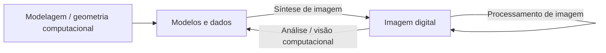

# Áreas da Computação Visual

A Computação Gráfica (ou Computação Visual) costuma ser dividida em duas grandes subáreas, e há outras divisões possíveis.

- **Síntese de imagens** (CG *gerativa*, visualização): gera imagens 2D a partir de modelos 3D. A entrada fica num espaço **contínuo** (vetorial), em geral o euclidiano 3D.
- **Análise de imagens** (visão computacional): recebe matrizes/imagens, num espaço **discreto** (raster), e extrai delas dados ou modelos.
- **Processamento de imagens:** transforma uma imagem em outra imagem.
- **Modelagem** (geometria computacional): cria os modelos e dados.

Relacionado: [[Representação Vetorial e Raster]] (contínuo × discreto)
